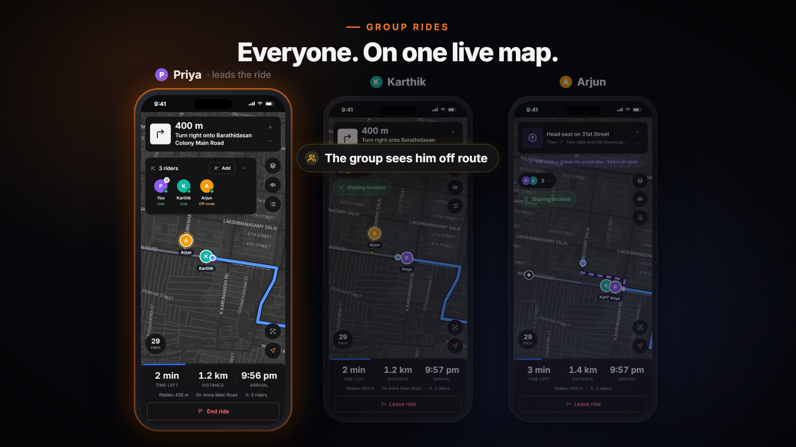

<div align="center">
  
  <h1>RideWise — Interactive GIS Landing Page</h1>
  <p><b>Every journey, connected.</b></p>
  <p>
    A zero-dependency, art-directed editorial landing page for the <b>RideWise</b> open-source navigation &amp; fleet-tracking platform — featuring a real-time <b>Antigravity Cartographic Physics</b> canvas, <b>2D Diagonal Bike Highway</b> &amp; <b>Tyre Zipper</b> launch transitions, and an interactive <b>GIS Telemetry Blog</b>.
  </p>

  <p>
    <a href="https://ride-wise.pages.dev">
      
    </a>
    <a href="https://res.cloudinary.com/ubhnc15t/video/upload/v1793038952/Ridewise_short_ad_1.mp4">
      
    </a>
    <a href="https://github.com/sGokulaKumaran/Ride-Wise">
      
    </a>
  </p>

  <p>
    
    
    
    
    
  </p>
</div>

<br />

<div align="center">
  
</div>

---

## What Makes This Landing Page Unique

Instead of shipping a heavy WebGL bundle or static template, the entire experience is powered by **four custom, zero-dependency vanilla JS engines** engineered for 60fps interactivity, dual-theme parity (`#07090e` Night Ride & `#F8FAFC` Day Ride), and effortless long-form readability.

| Engine / Controller | File | What It Does |
| :--- | :--- | :--- |
| **`CartographicBgEngine`** | [`landingBackground.js`](landingBackground.js) | Procedural 2D fBm + **Marching Squares** topographic iso-contours with **cursor gravity-well warping**, `96` spring-physics **antigravity particles & constellation tethers**, **click sonar shockwaves**, `500ms` **GPS breadcrumb cursor trail**, outer-margin live vector routes, and smooth `300ms` RGBA Dark/Light morphing. |
| **`LaunchTransitionController`** | [`landingPage.js`](landingPage.js) | Signature **Tyre Zipper** transition triggered by the topbar `"Try RideWise"` button — the tyre drops onto the topbar seam and unzips the screen horizontally into the RideWise launch portal. |
| **`RoadLaunchController`** | [`landingPage.js`](landingPage.js) | Cinematic **2D Illustrated Motorcycle + Rider** (`120×72px`) climbing a `42px` diagonal highway (`(0, H) → (W, 0)`) with launch wheelie pitch, suspension micro-bob, spinning spoked wheels, and diagonal portal peel on the bottom `"Try RideWise Free"` CTA. |
| **`BlogInteractiveController`** | [`landingBlog.js`](landingBlog.js) | Sticky **GIS Telemetry Ribbon** (live chapter `LAT / LON`, `01–06` jump pills, `km ↔ mi` unit toggle, scroll progress hairline), **4-Mindset** viewport-autoplay `.mp4` showcase, **2×2 Annotated Screenshot Bento** with clickable spatial hotspot pins + zoom Lightbox, and one-click clipboard copy. |
| **`ThemeController`** | [`landingPage.js`](landingPage.js) | 3-way **System / Light / Dark** switcher with live OS `prefers-color-scheme` sync and `localStorage` persistence. |

---

## Performance & Accessibility Guardrails

- **Readability Corridor & Matte Grain**: A subtle horizontal reading veil (`.rw-bg-corridor`) and inline SVG `feTurbulence` micro-grain (`.rw-bg-grain`) prevent dark-mode OLED banding while keeping central editorial prose crisp.
- **CPU & Battery Friendly**: `devicePixelRatio` is capped at `2`, `requestAnimationFrame` pauses automatically when the tab is hidden (`visibilitychange`), `.mp4` mindset clips pause when scrolled out of view, and mobile viewports (`<= 640px`) switch to a lightweight ambient preset.
- **`prefers-reduced-motion: reduce`**: Renders a crisp static architectural cartographic frame, disables looping video autoplay, and bypasses full-screen launch animations.

---

## Directory Structure

```text
LandingPage/
├── landingPage.html         # Semantic 6-chapter GIS blog + Zipper & Road launch overlays + Lightbox
├── landingPage.css          # Dual-theme tokens, reading corridor, bento, hotspots & responsive rules
├── landingPage.js           # ThemeController + LaunchTransitionController + RoadLaunchController
├── landingBackground.js     # CartographicBgEngine (contours, particles, sonar, GPS trail, routes)
├── landingBlog.js           # BlogInteractiveController (ribbon, km/mi, video tabs, hotspots, copy)
├── ridewise-icon-192.png    # App icon (192×192)
├── ridewise-icon-512.png    # App icon (512×512)
└── assets/                  # Self-contained promo clips & real app screenshots
    ├── hero-promo.png
    ├── clip-solo.mp4
    ├── clip-group.mp4
    ├── clip-college.mp4
    ├── clip-fleet.mp4
    ├── shot-solo.png
    ├── shot-group-rejoin.png
    ├── shot-passenger.jpg
    ├── shot-fleet-college.png
    └── shot-fleet-travels.png
```

---

## Quick Local Preview

Zero build steps, bundlers, or `npm install` required. Serve the `LandingPage/` directory with any static HTTP server:

```bash
# Python 3
python -m http.server 8765 --directory LandingPage

# Or Node.js
npx serve LandingPage -p 8765
```

Then open **`http://localhost:8765/landingPage.html`** in your browser.

> [!TIP]
> **Static Hosting (Cloudflare Pages / Netlify / GitHub Pages):** Point your static host's publish directory directly to `LandingPage/`. If your host expects `index.html`, either rename `landingPage.html` to `index.html` or add a rewrite rule to `landingPage.html`.

---

## Author & Contact

Built by **Gokula Kumaran**

- **Portfolio**: [gokulakumarans.pages.dev](https://gokulakumarans.pages.dev)
- **GitHub**: [github.com/sGokulaKumaran](https://github.com/sGokulaKumaran)
- **Email**: [gokulakumaran2007@gmail.com](mailto:gokulakumaran2007@gmail.com)
- **LinkedIn**: [linkedin.com/in/gokulakumaran](https://www.linkedin.com/in/gokulakumaran)
- **Live RideWise App**: [ride-wise.pages.dev](https://ride-wise.pages.dev)
